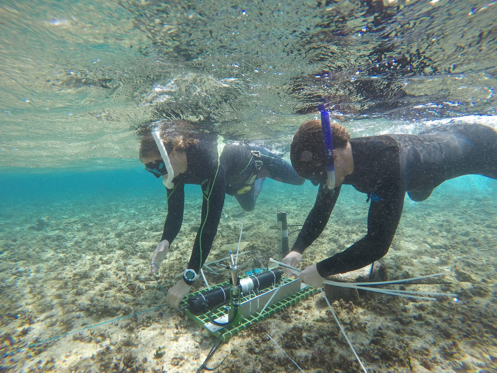
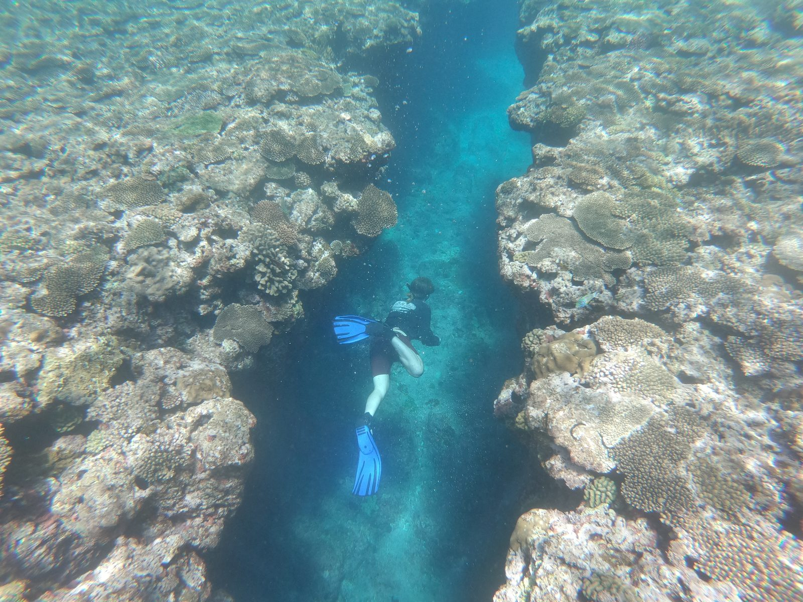

My research sits where coastal physics meets chemistry: how water movement, light and residence time shape the biogeochemistry of reefs, sediments and the coastal ocean. I combine field observations with process-based numerical models, using each to test the other.

## Ocean alkalinity enhancement and coastal sediments

Image coming soon

Ocean alkalinity enhancement (OAE) aims to increase the ocean's capacity to store carbon dioxide by adding alkalinity to seawater. But coastal sediments already generate alkalinity naturally, through carbonate dissolution, denitrification, anaerobic oxidation and pyrite burial, and they can respond to OAE in ways that offset part of its intended benefit.

In my postdoc at IMAS, I've developed a process-based reaction-transport model of coastal sediment biogeochemistry, spanning carbonate sands to cohesive, organic-rich muds, to resolve these alkalinity generation pathways. Coupling the model with a residence-time framework lets me ask how addition rate and hydrodynamic setting control how much of OAE's additionality is lost to sediment feedbacks. I'm also applying the model to field and laboratory data from collaborators at IMAS and the University of Chicago, and in 2026 helped collect samples in Trial Bay, Tasmania, to assess the ecological impacts of solid alkalinity feedstocks on the seafloor.

**In preparation:** *Alkalinal Recipes: Pathways of alkalinity generation within marine sediments*; *Coastal sediment feedbacks reduce the additionality of ocean alkalinity enhancement*.

## Physical controls on coral reef biogeochemistry

<figure>
  
</figure>

The chemistry of the water on a coral reef changes constantly as it flows over corals, algae and sediments that photosynthesise, respire, calcify and dissolve. How large those changes are depends as much on physics, such as flow speed, waves, light and residence time, as on the reef community itself.

During my PhD at Scripps Institution of Oceanography, I designed and led field campaigns on reefs in Okinawa and Kāneʻohe Bay, measuring flow, waves, light, pH and dissolved oxygen with ADCPs, ADVs, tilt current meters, SeapHOxes and drifters. This work showed how flow speed and light interact to control the magnitude and variability of reef carbonate chemistry. I then developed coupled hydrodynamic-biogeochemical models of reef flats to identify the physical drivers of characteristic features in reef time series, such as increases in pH and dissolved oxygen at night. I also led campaigns tracking how pH and oxygen variability within a seaweed farm in Okinawa changes over a growing season.

**Related papers:**
[Rintoul et al. 2022, *JGR Oceans*](https://doi.org/10.1029/2021JC018369) ·
[Kekuewa et al. 2026, *Estuaries and Coasts*](https://doi.org/10.1007/s12237-026-01770-x)

**In preparation:** *Things that gO2 bump in the night: Physical drivers of nocturnal increases in pH and dissolved oxygen on coral reefs*; *Physical fingerprints on pH and dissolved oxygen timeseries on coral reefs*.

## Reefs in a changing ocean

<figure>
  
</figure>

I've also worked on how reefs respond to warming and acidification. I modelled changes in dissolved oxygen for a global analysis showing that ocean warming will intensify hypoxia on coral reefs, and deployed moorings in Bocas del Toro, Panama, to investigate the physical conditions behind the onset and breakdown of hypoxic events. I've also contributed to work characterising present and future seawater CO₂ chemistry across reef habitats at Dongsha Atoll and Taiping Island in the South China Sea.

My Honours research on One Tree Island, in the southern Great Barrier Reef, showed that the interior framework of tropical algal ridges is cemented by alkalinity generated by sulfate-reducing bacteria, a mechanism that may make these ridges more resilient to ocean acidification.

**Related papers:**
[Pezner et al. 2023, *Nature Climate Change*](https://doi.org/10.1038/s41558-023-01619-2) ·
[Leplastrier et al. 2024, *Coral Reefs*](https://doi.org/10.1007/s00338-024-02509-5) ·
[Kekuewa et al. 2026, *Coral Reefs*](https://doi.org/10.1007/s00338-026-02868-1)

